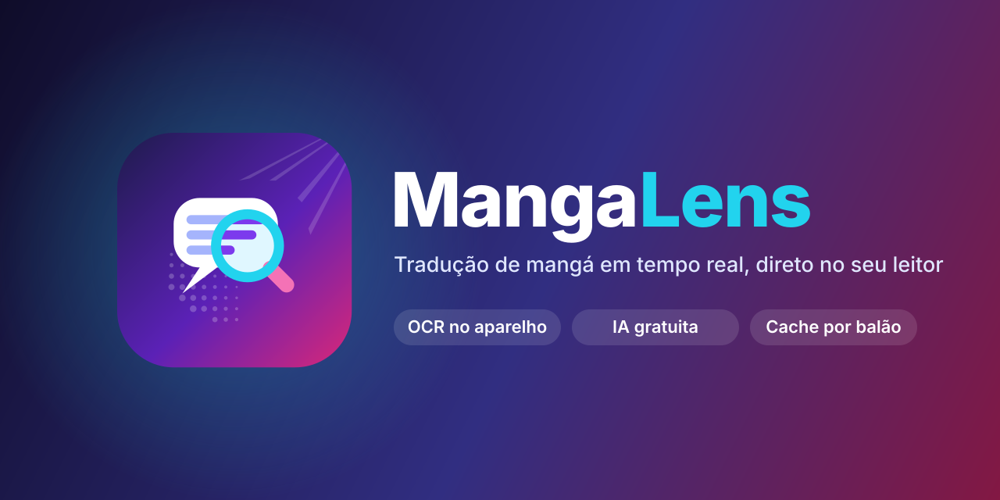

<div align="center">




</div>

---

## O que é

MangaLens é uma **lupa de tradução flutuante** para mangás, manhwas e webtoons. Funciona sobre leitores Android como Mihon, Tachiyomi, Komikku e Kotatsu: captura a tela via `MediaProjection` e desenha as traduções por cima dos balões.

### Como funciona

```text
Você lê no seu app favorito
   |
   | 3x por segundo: miniatura 36x64 da tela (sem rede, sem custo)
   v
A tela parou em conteúdo novo?  -- não --> não faz nada
   | sim
   v
OCR no aparelho (ML Kit) encontra os textos e a posição exata de cada balão
   |
   | balões já traduzidos vêm do cache (sem custo)
   v
Só os textos NOVOS vão para a OpenRouter, em uma única requisição de texto
   |
   v
Traduções desenhadas sobre os balões, com fonte ajustada ao tamanho de cada um
```

A **posição** de cada tradução vem sempre do OCR (modelos de IA gratuitos erram coordenadas). Com o motor "OCR + IA vendo a imagem" (Configurações), a página também é enviada como imagem para o modelo corrigir erros do OCR e ler texto vertical — mais preciso, porém mais lento.

### Por que é econômico

| Situação | Custo |
|---|---|
| Tela parada (você lendo) | Zero — nenhum frame novo, nenhum processamento |
| Rolando a página | Zero — só compara miniaturas |
| Página sem texto | Zero — o OCR local não acha texto, nada é enviado |
| Balão que já foi traduzido (rolar webtoon, voltar página) | Zero — cache |
| Balões novos | 1 requisição **só de texto** por tela |

A versão anterior reenviava a tela inteira como imagem a cada ~5 s, porque os próprios overlays e a bolha flutuante apareciam na captura e faziam a tela parecer "diferente". Isso foi eliminado: as regiões desenhadas pelo MangaLens são ignoradas na detecção de mudança.

## Funcionalidades

| Feature | Descrição |
|---|---|
| 🔍 **OCR no aparelho** | ML Kit (latim, japonês, coreano, chinês) — posições exatas, sem rede. |
| 🌐 **Tradução contextual** | Os balões da página vão juntos, com as últimas falas como contexto (nomes, gênero, tom). |
| 🆓 **OpenRouter grátis** | Usa apenas modelos `:free`, com fallback automático entre eles. |
| ⏱️ **Espera inteligente** | Traduz quando a tela fica parada ~0,4 s em conteúdo novo. |
| ⚡ **Balões progressivos** | A resposta da IA chega em streaming: cada balão aparece assim que é traduzido, sem esperar a página inteira. |
| 🧠 **Cache** | Por balão (OCR mode) e por página (modo visão). |
| 🚦 **Limites respeitados** | Espaça requisições (20/min), conta o uso diário e respeita o `Retry-After` de um 429. |
| 🪟 **Overlay que não atrapalha** | Uma única camada que ignora toques: o leitor continua rolando normalmente. |
| 🔐 **Backend opcional** | Proxy que guarda a chave fora do APK e só aceita modelos gratuitos. |

## Usando a bolha flutuante

| Gesto | Ação |
|---|---|
| Arrastar | Move a bolha |
| Tocar | Liga/pausa a tradução automática (no modo Manual: traduz a tela / esconde a tradução) |
| Segurar ~0,5 s | Força uma nova tradução da tela atual |
| ✖ | Encerra o tradutor |

Estados: `AUTO ●` (ativo), `AGUARDANDO...` (tela em movimento), `LENDO...` (OCR), `TRADUZINDO...` (API), `LIMITE ⏳` (limite da API — tenta de novo sozinho), `ERRO ●` (segure para tentar de novo). A notificação mostra quantas requisições foram usadas hoje.

Em **Configurações** escolha o modo (Automático/Manual) e o motor (OCR + texto, ou IA lê a imagem).

## Configurar a OpenRouter

**APK baixado de uma Release:** abra **Configurações → Chave da OpenRouter**, cole a chave criada em [openrouter.ai/settings/keys](https://openrouter.ai/settings/keys) e toque em **Salvar**. A chave fica só no aparelho (excluída do backup) e tem prioridade sobre qualquer outra configuração.

**Build local (teste pessoal):**

1. Crie uma conta e uma chave em [openrouter.ai/settings/keys](https://openrouter.ai/settings/keys).
2. Adicione ao `local.properties` (já ignorado pelo Git — a chave **nunca** vai para o repositório):

```properties
OPENROUTER_API_KEY=sk-or-v1-...
```

3. Gere e instale o APK (abaixo). Com a chave definida o app chama a OpenRouter direto — não precisa de backend nem de PC ligado.

Opcional no mesmo arquivo:

```properties
# Modelos em ordem de preferência (todos gratuitos, no máximo 3: limite da OpenRouter). A lista de modelos free muda com o tempo:
# https://openrouter.ai/models?max_price=0
OPENROUTER_TEXT_MODELS=dots-studio/dots-3-note-preview:free,nvidia/nemotron-3-super-120b-a12b:free,nvidia/nemotron-3-ultra-550b-a55b:free
OPENROUTER_VISION_MODELS=nvidia/nemotron-3.5-super-vl:free,dots-studio/dots-3-note-preview:free,google/gemma-4-31b-it:free
# Limite diário que o app impõe a si mesmo (free: 50/dia; 1000/dia após comprar 10 créditos uma vez)
OPENROUTER_DAILY_LIMIT=50
```

> **Limites do plano gratuito:** 20 requisições/minuto e **50 por dia** sem créditos (1000/dia depois de comprar US$ 10 em créditos uma única vez). Graças ao cache, uma leitura típica gasta 1 requisição por tela com falas novas. Quando o limite diário acaba, os balões já traduzidos continuam aparecendo.

> A chave embutida no APK só serve para uso pessoal: qualquer pessoa com o APK consegue extraí-la. Para distribuir, use o backend.

## Requisitos

- JDK 17 completo.
- Android SDK 35.
- Android 7.0 / API 24 ou superior.
- Node.js 18+ apenas se for usar o backend.

## Corrigir o JDK no VS Code

O Gradle 9.3.1 e o Android Gradle Plugin deste projeto exigem Java 17 ou superior. Se o console informar que está usando JVM 8, feche todas as janelas do VS Code e abra uma nova a partir do PowerShell com o JDK correto:

```powershell
$env:JAVA_HOME="$env:USERPROFILE\.jdk\jdk-17.0.12+7"
$env:Path="$env:JAVA_HOME\bin;$env:Path"
code .
```

Confirme no terminal integrado:

```powershell
java -version
.\gradlew.bat --version
```

Os dois comandos devem mostrar Java 17. Depois execute `Developer: Reload Window` no VS Code. Se o aviso "build file has been changed" continuar, execute `Java: Clean Java Language Server Workspace` e reabra o projeto.

O arquivo `.vscode/settings.json` usa `${env:JAVA_HOME}` para que o projeto não dependa de um caminho absoluto de outra máquina.

## Gerar e instalar o APK

```powershell
$env:JAVA_HOME="$env:USERPROFILE\.jdk\jdk-17.0.12+7"
.\gradlew.bat :app:testDebugUnitTest
.\gradlew.bat :app:assembleDebug
adb install -r app\build\outputs\apk\debug\app-debug.apk
```

Ou, com o celular conectado: `.\gradlew.bat installDebug`.

No app:

1. Toque em **Ativar tradução automática**.
2. Conceda **Exibir sobre outros apps** e autorize a captura de tela (escolha "Tela inteira").
3. Abra o leitor de mangá. Ao parar numa página, a bolha mostra `LENDO...` → `TRADUZINDO...` → `AUTO ●` e as traduções aparecem.
4. Role a página: as traduções somem durante a rolagem e voltam ao parar (balões já vistos voltam instantaneamente, sem custo).

Para testar sem outro app: na tela inicial, importe uma imagem de mangá — ela passa pelo mesmo pipeline.

### Observar logs

```powershell
adb logcat -c
adb logcat | Select-String "MangaLens|AndroidRuntime"
```

Cada tradução registra o tempo do OCR e da API, cada requisição `model=... tokens=...` e um resumo por página:

```text
Página: ocr=10 cacheHits=0 solicitados=10 recebidos=0 válidos=0 exibidos=0 tentativas=2 modelos=nvidia/...-content-safety,dots-... motivo=estrutura_inválida
```

`recebidos` são ids devolvidos pelo modelo, `válidos` os aceitos (id pedido, sem eco do texto original, tamanho razoável) e `exibidos` o que foi desenhado. Quando um modelo responde "ok" sem traduções úteis (ex.: um modelo de *content safety* escolhido pelo fallback), o app repete **uma vez** só com os balões faltantes, começando por outro modelo.

## Testes

```powershell
.\gradlew.bat :app:testDebugUnitTest
```

Cobrem o pipeline de tradução com respostas simuladas (cache, ids fora do padrão, resposta vazia, streaming, limites), o cliente HTTP e o ajuste do texto aos balões (inclusive com o `StaticLayout` real via Robolectric).

Teste de qualidade com um modelo real (opcional, gasta cota — nunca roda no CI):

```powershell
$env:MANGALENS_LIVE_TEST="1"
# usa OPENROUTER_API_KEY do local.properties; para testar também na OpenAI:
# $env:OPENAI_API_KEY="sk-..." ; $env:OPENAI_MODEL="gpt-4.1-mini"
.\gradlew.bat :app:testDebugUnitTest --tests "*LiveTranslationTest*"
```

## Release automática por tag

O workflow `.github/workflows/build.yml` roda os testes do backend e do app e gera o APK em todo push na `main`, PR e execução manual. Ao subir uma tag `v*`, cria uma **GitHub Release** com os APKs:

```powershell
git tag v1.0.0
git push origin v1.0.0
```

- `versionName` vem da tag (`v1.0.0` → `1.0.0`) e `versionCode` do número da execução.
- Tags com hífen (`v1.1.0-beta`) viram *pre-release*.
- Nenhuma chave de API é embutida: o usuário cola a dele nas Configurações. Opcionalmente defina os secrets `TRANSLATION_API_BASE_URL` (backend público, **https**) e `TRANSLATION_API_TOKEN` (o mesmo valor de `MANGALENS_APP_TOKEN` no backend). Sem `TRANSLATION_API_BASE_URL` o APK não tenta nenhum backend e pede a chave nas Configurações.
- Assinatura (opcional, recomendada para atualizar sem desinstalar): secrets `KEYSTORE_BASE64` (`base64 -w0 release.jks`), `STORE_PASSWORD`, `KEY_ALIAS`, `KEY_PASSWORD`. Sem eles o APK de release é assinado com a chave debug do runner.

## Backend (opcional, pasta `back/`)

O projeto **não depende de backend**: sem nenhum configurado (o padrão), cada usuário cola a própria chave grátis da OpenRouter em Configurações. A pasta `back/` só é necessária se um dia você quiser hospedar um proxy que guarde a chave fora do APK.


Sem chave (nas Configurações ou `OPENROUTER_API_KEY` no `local.properties`), o app usa o backend em `TRANSLATION_API_BASE_URL`. **Não há valor padrão**: sem backend configurado, o app pede a chave. Para o backend local no emulador, adicione ao `local.properties`:

```properties
TRANSLATION_API_BASE_URL=http://10.0.2.2:8080
```

O backend é um proxy fino para a OpenRouter: injeta a chave, **recusa modelos pagos** e repassa as respostas em streaming (os balões aparecem um a um também via backend).

```powershell
cd back
Copy-Item .env.example .env
# Edite back/.env e informe OPENROUTER_API_KEY (e MANGALENS_APP_TOKEN se o backend for público)
npm test
npm start
```

Verifique em `http://localhost:8080/health`. Para celular físico, use o IPv4 do computador (mesma rede Wi-Fi) e libere a porta TCP 8080 no firewall:

```powershell
.\gradlew.bat :app:assembleDebug -PTRANSLATION_API_BASE_URL=http://192.168.1.100:8080
```

O build debug permite HTTP sem TLS para esse backend local; o release não.

Variáveis do backend (`back/.env`):

| Variável | Para quê |
|---|---|
| `OPENROUTER_API_KEY` | Chave usada para todos os usuários do backend. |
| `MANGALENS_APP_TOKEN` | **Recomendado se o backend for público.** Exige o header `X-MangaLens-Token`; gere o APK com `TRANSLATION_API_TOKEN` igual. Sem ele, qualquer um que descobrir a URL gasta a sua cota. |
| `TRUST_PROXY=1` | Só atrás de proxy reverso (Render, Railway, Fly, nginx): limita cada celular pelo `X-Forwarded-For`, em vez de todos dividirem o IP do proxy. |
| `PER_CLIENT_RATE_LIMIT` / `GLOBAL_RATE_LIMIT` | Requisições por minuto por celular (padrão 10) e no total da chave (padrão 18; a OpenRouter free permite 20/min por chave). |

Endpoints:

- `GET /health`
- `POST /v1/chat/completions` — corpo no formato OpenAI/OpenRouter (`models`, `messages`, ...); somente modelos `:free` ou `openrouter/free`.

## Estrutura

```text
app/src/main/java/com/example/
  service/MangaOverlayService.kt      Bolha flutuante + loop de detecção de mudança
  service/ScreenCaptureManager.kt     MediaProjection; frames convertidos só sob demanda
  service/TranslationOverlayLayer.kt  Cards de tradução (não interceptam toques), desenha o layout medido
  service/StaticLayoutMeasurer.kt     Mede o texto com o mesmo StaticLayout usado para desenhar
  translation/BubbleTextFitter.kt     Escolhe tamanho da fonte e do card para cada balão
  translation/BlockTranslator.kt      Cache, validação por id, nova tentativa, estatísticas da página
  translation/                        OCR, cache, prompts, orçamento de requisições, pipeline
  data/remote/OpenRouterClient.kt     Cliente OpenRouter (fallback de modelos, 429)
back/src/server.js                    Proxy OpenRouter (opcional)
```

## Troubleshooting

| Problema | Solução |
|---|---|
| `Configure a chave da OpenRouter` | Cole a chave em Configurações → Chave da OpenRouter (ou no `local.properties` e gere o APK de novo). |
| `Resposta da IA sem traduções válidas` | Os modelos da lista responderam sem o JSON esperado; veja `modelos=` no log e troque `OPENROUTER_TEXT_MODELS`. |
| `LIMITE ⏳` | Limite por minuto/dia da OpenRouter. Aguarde; o app tenta sozinho. |
| `ERRO ●` com "OpenRouter: ..." | Modelo indisponível: troque `OPENROUTER_TEXT_MODELS` por modelos free atuais. |
| Nada é traduzido | Confira se a captura é "Tela inteira" e se o idioma de origem está certo (ou "Detectar"). |
| Texto lido errado (OCR) ou mangá vertical | Use o motor "OCR + IA vendo a imagem" nas Configurações. |
| Tradução lenta | Veja no logcat `OCR: ... ms` e `API: ... ms` para saber qual etapa demora; modelos free variam de velocidade, ajuste `OPENROUTER_TEXT_MODELS`. |
| Backend não conecta | `npm start` em `back/`, `/health`, IPv4 correto e firewall. |
| Backend responde `401` | `TRANSLATION_API_TOKEN` do APK diferente de `MANGALENS_APP_TOKEN` do backend. |
| Captura só mostra o MangaLens / tela preta | No Android 14+ o app já pede "Tela inteira"; se o sistema ainda oferecer, não escolha "Um único app". |
| Limite diário errado | Configurações → Limite diário: 50 (grátis) ou 1000 (com créditos). O dia é contado em UTC, como na OpenRouter (vira às 21h de Brasília). |
| APK não compila | Confirme JDK 17 e Android SDK 35. |

## Licença

MIT. Consulte [LICENSE](LICENSE).
