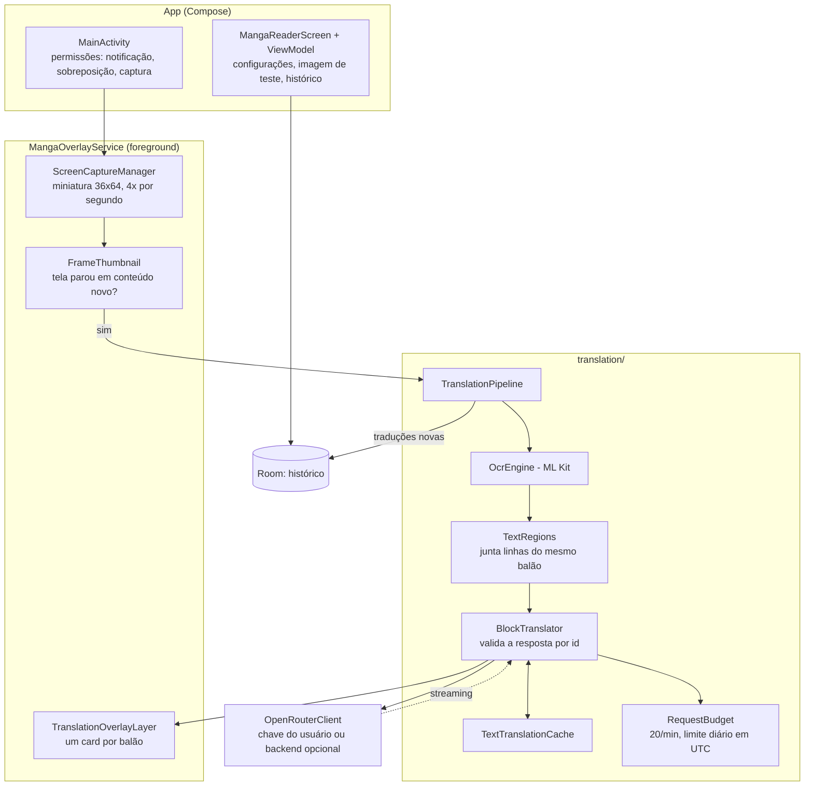

# MangaLens — Arquitetura

O MangaLens é um app Android (Kotlin, Jetpack Compose) que traduz mangás, manhwas e webtoons por cima de qualquer leitor. A tela é capturada com `MediaProjection`, o texto e a posição de cada balão vêm do OCR do aparelho (ML Kit) e só os textos novos vão para a OpenRouter (modelos `:free`). As traduções são desenhadas em janelas de sobreposição que deixam o toque passar para o leitor.

Leia também o `agents.md` (regras do projeto) antes de alterar o código.

## 1. Fluxo de uma página



Quando a tela está parada numa página já tratada, nada roda: nem OCR, nem rede. Balões já traduzidos vêm do cache, e cada página com texto novo custa uma requisição só de texto (ou com imagem, no motor "OCR + IA vendo a imagem").

## 2. Pacotes

`app/src/main/java/com/example/`:

| Pacote | Arquivos | Papel |
| --- | --- | --- |
| raiz | `MainActivity.kt` | Pede notificação (13+), sobreposição e captura da tela inteira (14+) e inicia o serviço |
| `service/` | `MangaOverlayService.kt` | Bolha flutuante, laço de detecção de mudança, status, notificação e histórico |
| | `ScreenCaptureManager.kt` | `VirtualDisplay` + `ImageReader`; miniaturas baratas e bitmap só quando vai traduzir |
| | `TranslationOverlayLayer.kt`, `StaticLayoutMeasurer.kt` | Desenha os cards com o mesmo `StaticLayout` que foi medido |
| `translation/` | `TranslationPipeline.kt` | OCR → regiões → cache → API |
| | `OcrEngine.kt`, `TextRegions.kt`, `Box.kt` | OCR (latim, japonês, coreano, chinês) e agrupamento dos balões |
| | `BlockTranslator.kt`, `TranslationPrompts.kt` | Prompt, streaming, validação por id, nova tentativa |
| | `TranslationCache.kt`, `RequestBudget.kt` | Cache tolerante a ruído de OCR e cota da OpenRouter |
| | `BubbleTextFitter.kt`, `FrameThumbnail.kt`, `ScreenMath.kt` | Lógica pura (testada na JVM): tamanho da fonte, mudança de tela, limites de tela e imagem |
| `data/remote/` | `OpenRouterClient.kt` | OkHttp + `org.json`; fallback de modelos, streaming SSE, 429 com `Retry-After` |
| `data/local/` | `UserPreferencesRepository.kt` | Preferências em `SharedPreferences`; a chave fica em `manga_lens_secrets` (fora do backup) |
| | `AppDatabase.kt`, `TranslationHistory.kt` | Histórico em Room (instância única, até 200 linhas) |
| `ui/` | `reader/`, `components/`, `theme/` | Tela principal, configurações, pré-visualização da imagem de teste |

Fora do app:

- `back/`: proxy Node.js **opcional** que guarda a chave da OpenRouter num servidor. O projeto não tem backend em produção; sem `TRANSLATION_API_BASE_URL`, cada usuário cola a própria chave nas Configurações.
- `.github/workflows/build.yml`: testes do backend e do app e APK de debug em push na `main`, `fix/**`, `feat/**` e em PRs; release com APK em tags `v*`.

## 3. Compilar

| Componente | Versão |
| --- | --- |
| JDK | 17 completo (com `jlink`) |
| Android SDK | compileSdk 35, targetSdk 35, minSdk 24 |
| Gradle / AGP | 9.3.1 / 9.1.1 |

```powershell
$env:JAVA_HOME="$env:USERPROFILE\.jdk\jdk-17.0.12+7"
.\gradlew.bat :app:testDebugUnitTest
.\gradlew.bat :app:assembleDebug
```

O `local.properties` (fora do Git) precisa de `sdk.dir=C:/Users/<seu-usuario>/AppData/Local/Android/Sdk`; para testes pessoais, também pode ter `OPENROUTER_API_KEY=...`. O APK sai em `app/build/outputs/apk/debug/`.

## 4. Testar no celular

1. Instale o APK (permita "fontes desconhecidas").
2. Em **Configurações → Chave da OpenRouter**, cole uma chave grátis de [openrouter.ai/keys](https://openrouter.ai/keys).
3. Toque em **Ativar tradução automática** e aceite notificação, sobreposição e captura da tela inteira.
4. Abra o leitor (Mihon, Komikku, Kotatsu...) e leia normalmente; a bolha mostra o status.
5. Logs: `adb logcat -s MangaLens` (a linha `Página: ocr= cacheHits= ...` resume cada página).

## 5. Regras para agentes de IA

1. Leia `agents.md` antes de alterar o código.
2. Não commite `local.properties`, chaves nem caminhos absolutos do seu computador.
3. Composables em `CamelCase`, com `modifier: Modifier = Modifier` como parâmetro opcional.
4. Lógica nova que puder ser Kotlin puro vai em `translation/`, com teste JUnit.
5. Valide com `:app:testDebugUnitTest` e `:app:assembleDebug`, ou deixe o CI da branch `fix/**` validar.
